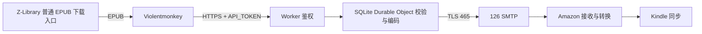

# 完整部署与使用指南

[返回简明 README](../README.md)。本页保留完整操作步骤；首次使用可先按 README 的快速流程完成，遇到具体问题再查这里。

| 要做什么 | 跳转 |
| --- | --- |
| 配置 Kindle 地址和白名单 | [Kindle 邮箱](#2-设置-kindle-邮箱和白名单) |
| 取得客户端授权码 | [开启 126 SMTP](#3-开启-126-smtp) |
| 准备秘密配置、部署服务 | [四个配置值](#4-准备四个配置值) · [Cloudflare 部署](#5-一键部署到-cloudflare) |
| 安装扩展与脚本 | [Windows](#71-windows安装暴力猴扩展) · [Android](#72-android安装暴力猴扩展) · [向导](#6-部署后跟着四步向导完成) |
| 正常安装失败 | [备用安装](#75-没有安装弹窗时的备用方法) |
| 本地上传与验收 | [手动测试](#9-手动上传与首次收书验收可选) |
| 更换配置、旧版迁移 | [修改与更新](#修改更新和停用) |
| 查询错误 | [常见问题](#常见问题) |
| 命令行部署 | [开发与手动部署](#开发与手动部署) |

公开脚本安装后，回到项目仓库页刷新，在连接栏填写自己的 Worker HTTPS 网址；也可从暴力猴菜单选择“连接或更换自己的 Cloudflare 服务”。仓库页面只填网址，不填令牌。打开自己的 `/setup` 页面时可确认预填的网址；连接后在自己的服务内验证并保存 API_TOKEN。

## 功能与边界

- 同一份 Violentmonkey 脚本用于 Windows Firefox 和支持该扩展的 Android Firefox；两台设备分别安装、分别保存令牌。
- 只使用当前页面可见、用户原本有权使用的普通 HTTPS 下载链接；不绕过 Premium、验证码、付费或下载次数限制。
- 支持 `/setup` 页面上传本地 EPUB，网站下载入口不兼容时也能使用。
- 原文件最大 **50,000,000 字节（十进制 50 MB）**，不是 50 MiB。可在项目配置中调低上限。
- SMTP 使用 `smtp.126.com:465` 的 implicit TLS；在 TLS 内使用服务器声明的 AUTH PLAIN 或 LOGIN，不依赖通用 Node SMTP 库。
- 请求要有 API_TOKEN；收件人固定为部署者配置的 KINDLE_EMAIL，客户端不能指定任意收件人。
- 同一服务一次只处理一本书；文件只在处理期间位于内存，不写入书籍数据库。
- **126 接收邮件不等于 Kindle 已入库。** 还需要 Amazon 接收、转换和设备同步。
- **50 MB 是程序接收上限，不是投递保证。** Base64 与换行会让 50 MB 附件变成约 68.4 MB 的整封邮件。126 和 Amazon 各自的规则仍然生效。



### 免费运行的条件

使用 **Workers Free** 和 **SQLite 类型 Durable Object**。项目不需要 R2、付费服务器或付费邮件服务，也不会自动替你升级套餐。Cloudflare 官方支持在 Free 计划使用 SQLite Durable Objects；普通 Worker 与 Durable Object 的 CPU 配额不同，本项目把附件处理放在后者。[官方定价](https://developers.cloudflare.com/durable-objects/platform/pricing/)、[限制](https://developers.cloudflare.com/durable-objects/platform/limits/)。

免费额度按账号共享，其他 Worker 也可能消耗额度；超过免费额度可能导致请求失败。若账号本来在 Paid 计划，实际费用按该账号套餐计算。上线时核对套餐及用量，不把“开源”理解成“任何用量都免费”。

## 1. 准备账号和浏览器

| 项目 | 用途 | 注意 |
| --- | --- | --- |
| Cloudflare 账号 | 部署服务 | 使用 Workers Free；一键部署针对 Workers，不是 Pages |
| GitHub 账号 | 保存一键部署创建的项目副本 | 按 Cloudflare 页面授权；不需要把密码或令牌提供给维护者 |
| 126 邮箱 | SMTP 发信 | 需能开启 SMTP 并取得客户端授权码 |
| Amazon / Kindle 账号 | 接收文档 | Kindle 设备或 App 登录相应账号、联网同步 |
| Firefox + Violentmonkey | 页面推送按钮 | 安卓需确认当前 Firefox 允许安装该扩展；iOS 不在支持范围 |

一键部署使用者无需安装 Node.js、Git 或修改 JavaScript。命令行仅用于维护、开发和备用部署。

## 2. 设置 Kindle 邮箱和白名单

### 2.1 找到真正的 Kindle 接收地址

1. 登录与 Kindle 设备相同的 Amazon 账号，进入 **管理您的内容和设备 / Manage Your Content and Devices**。
2. 在 **偏好设置 / Preferences → 个人文档设置 / Personal Document Settings** 找到 **发送至 Kindle 电子邮箱设置 / Send-to-Kindle E-mail Settings**。
3. 选择要接收文档的设备或 App，记录其接收邮箱，通常以 `@kindle.com` 结尾。

不同地区和界面的菜单文字可能不同，以账号实际显示为准。**Amazon 登录邮箱、126 发件邮箱和 Kindle 接收邮箱是三个不同用途，不要填混。** 多设备可能各有接收地址。

### 2.2 重点：Kindle 邮箱前缀不要照搬发件邮箱

建议为 Kindle 地址设置一个**与发件邮箱及其他常用邮箱明显不同、难以猜测的前缀**。这里的前缀是 `@` 前面的部分，不是只把域名换成 `kindle.com`。

| 发件邮箱（示意） | Kindle 邮箱（示意） | 说明 |
| --- | --- | --- |
| `reader_2026@126.com` | `reader_2026@kindle.com` | 前缀完全相同，不建议 |
| `reader_2026@126.com` | `reader_2026_kindle@kindle.com` | 仍包含完整发件前缀，不建议照搬 |
| `reader_2026@126.com` | `q7m9v2n8r4p6@kindle.com` | 示意独立且难猜的前缀；请自行生成，不要照抄这个地址 |

**这不是“两个邮箱不能有任何相同字母/数字”的硬性要求。** 项目没有依据把任意字符重合判为错误，也不会因此禁止发信。Amazon 员工曾建议使用不同于其他邮箱的安全 Kindle 地址，以减少额外验证；这不保证永远免验证，最终以 Amazon 的实际提示为准。[Amazon 官方论坛说明](https://www.amazonforum.com/s/question/0D56Q00008SND1OSAX/i-want-to-transfer-ebooks-to-my-kindle-and-android-phone-without-the-2level-security)

在 Amazon 地址旁点击编辑可修改前缀。**修改后必须把 Cloudflare 的 `KINDLE_EMAIL` 同步更新成新地址。** 改 Kindle 前缀无需改 126 邮箱，也无需把 SMTP 授权码重新填进脚本。

本项目向导的“验证连接并保存”和手动“检查服务版本”会对完全相同或明显包含关系的前缀给出 `MAILBOX_PREFIX_SIMILAR` 提示。这只是简单辅助检查，不能替代 Amazon 的安全判断。

### 2.3 添加已认可发件人

1. 在同一页找到 **已认可的发件人电子邮箱列表 / Approved Personal Document E-mail List**。
2. 添加实际用于发信的**完整 126 邮箱地址**，与稍后 `SMTP_USER` 完全一致。
3. 不要填 Kindle 接收地址，也不要只填 `126.com` 或 `@126.com`。
4. 如果 Amazon 发送“确认文档”邮件，按照邮件提示完成确认，同时检查垃圾邮件文件夹。

白名单和安全前缀是两件事，不能相互代替。[Amazon 邮件投递说明](https://digprjsurvey.amazon.co.uk/csad/help/node/G7NECT4B4ZWHQ8WV)

## 3. 开启 126 SMTP

1. 在浏览器登录自己的 [126 邮箱](https://mail.126.com/)。
2. 打开设置，找到 **POP3/SMTP/IMAP** 或客户端协议相关设置。
3. 按界面开启包含 SMTP 的客户端服务，完成邮箱要求的手机或安全验证。
4. 新建并保存**客户端授权码/授权密码**，用于 `SMTP_AUTH_CODE`。
5. `SMTP_USER` 填完整发件邮箱。不要把网页登录密码当授权码。

本项目已固定 126 的服务器、465 端口和 implicit TLS。使用者无需填这些参数；其他邮件服务商、STARTTLS/587、OAuth2 未纳入当前版本支持范围。网易设置页面若发生变化，以邮箱自身显示为准。[网易客户端设置帮助](https://help.mail.126.com/faqDetail.do?code=d7a5dc8471cd0c0e8b4b8f4f8e49998b374173cfe9171305fa1ce630d7f67ac25c12dcb3d46222b6)

## 4. 准备四个配置值

| Secret 名称（大小写准确） | 应填内容 | 不能填成 |
| --- | --- | --- |
| `API_TOKEN` | 自己生成、私下保存的随机访问令牌，推荐 64 位十六进制字符 | Cloudflare 账号 API Token、邮箱授权码 |
| `SMTP_USER` | 完整 126 发件邮箱 | Kindle 接收地址、仅用户名 |
| `SMTP_AUTH_CODE` | 126 的客户端授权码 | 邮箱网页登录密码 |
| `KINDLE_EMAIL` | Amazon 中显示的 Kindle 接收邮箱 | Amazon 登录邮箱、126 发件邮箱 |

生成 API_TOKEN 的方法任选一种：

- 用密码管理器生成至少 32 位随机字符，不含空格，使用可见 ASCII；本项目接受 32–256 位。
- 下载项目中的 [本地令牌生成器](../tools/token-generator.html)：在 GitHub 文件页点击 **Download raw file / 下载原始文件**，保存 HTML 后用浏览器打开，点击生成。页面无外部脚本、无网络请求，使用本机 Web Crypto 随机数；不要在来源不明的在线网站生成。
- 已有 Node.js 的用户可执行 `npm run token`。命令只生成并显示，不上传或修改服务器；请私下保存输出。

部署表单和各浏览器必须使用**同一个 API_TOKEN**。不需要把任何秘密写进仓库、README、油猴源码或 Issue。`.dev.vars.example` 只声明四个名称，公开文件中的值故意留空。

## 5. 一键部署到 Cloudflare

1. 点击[项目 README](../README.md)顶部的 **Deploy to Cloudflare** 按钮。
2. 登录自己的 Cloudflare 和 GitHub，按页面授权 Cloudflare 创建项目副本。选择自己的账号和仓库名称。
3. 保留 Worker 默认名称或按需更名；不要启用额外付费产品。四个 Secrets 按上一节填写。
4. 若页面展示构建参数，核对如下：

   | 参数 | 值 |
   | --- | --- |
   | 根目录 | 仓库根目录 |
   | 构建命令 | `npm run build` |
   | 部署命令 | `npm run deploy` |
   | Node.js | 24.15+，推荐 24 LTS 最新补丁版 |
   | 依赖 | 使用随仓库提供的 `package-lock.json` |

5. 点击部署，等待构建完成。SQLite Durable Object 的绑定和 migration 已在 `wrangler.jsonc` 中声明，不用自己创建数据库或复制绑定 ID。
6. 打开 Cloudflare 提供的**生产服务网址**，不要使用预览网址。根路径自动跳转到 `/setup`；`/panel` 是兼容入口。
7. 在 Settings / Bindings 中应看到 `MAIL_SENDER → MailSender`。四个业务配置应以 Secret 类型保存。

项目按 Cloudflare 官方部署按钮约定提供 `.dev.vars.example` 和字段说明；官方支持自动创建 Durable Objects。若平台界面没有展示秘密输入，先在当前 Worker 的 **Settings → Variables and Secrets** 补齐四个 **Secret**，再重新部署。不要把值粘贴到构建日志或普通公开变量文件。[部署按钮机制](https://developers.cloudflare.com/workers/platform/deploy-buttons/)

**部署网址无需填写到任何源码。** 从你自己服务的安装页下载脚本，脚本会自动绑定这个服务地址。若日后换域名，需要从新地址重新安装脚本。

## 6. 部署后跟着四步向导完成

已经从 README 按钮安装并连接脚本时，会直接进入连接步骤，不用重复安装。也可以在实际使用的 Firefox 打开自己的生产服务网址，自动进入 `/setup`。安装和配置集中在同一页，**正常流程不用编辑代码，也不用复制脚本全文**。

| 向导步骤 | 你需要做什么 | 如何确认成功 |
| --- | --- | --- |
| 1. 安装暴力猴 | 点“打开暴力猴官方安装页”，在 Firefox 确认添加；返回点“已安装，继续” | Firefox 扩展列表里已启用 Violentmonkey；网页上的继续按钮只是你的确认 |
| 2. 安装推送脚本 | 点“安装正式推送脚本 3.2.0”，在暴力猴确认安装；返回检查或刷新 | 页面检测到正式脚本 3.2.0，然后进入连接步骤 |
| 3. 连接并保存 | 输入部署时的 API_TOKEN，点“验证连接并保存” | 服务检查及 SMTP 登录均通过，令牌才保存，输入框清空；阅读提醒后点“继续启用书籍网站” |
| 4. 启用书籍网站 | 粘贴你正常使用的 Z-Library HTTPS 书籍详情页网址，点“启用此站并打开书籍页” | 当前域名已启用，在新标签页打开书籍页；由你点击推送按钮才下载、发信 |

步骤 3 **不会发邮件**，也不会下载书籍。密码框中填写的是本工具的 API_TOKEN，不是邮箱授权码。若本机已经保存令牌，可留空点击验证；扩展不会把私有存储中的令牌回填到网页。

网站启用记录只保存网址的 `https://域名[:端口]`，不保存完整书籍链接、路径或查询参数。正常打开所填网址仍会把该网址发送给对应网站。镜像换域名后需要重新启用；本工具不替你寻找镜像或绕过限制。

**安装扩展与安装脚本的浏览器确认不能省略。** 网页无法静默安装暴力猴，也不能只凭“未检测到脚本”判断暴力猴没装。电脑和手机各配置一次，不自动同步本机令牌。没有扩展时仍可用第 9 节手动上传。

## 7. 安装与配置详解

本节是向导各步的详细说明和故障处理。已经顺利完成四步向导的使用者，直接进入第 8 节。

**先装暴力猴扩展，再装 Z-Library → Kindle Push 正式脚本。** 两者缺一不可。必须在实际安装 Violentmonkey 的 Firefox 中打开服务页。

### 7.1 Windows：安装暴力猴扩展

1. 打开 **Firefox**，不要在 Edge、Chrome 或聊天软件内置浏览器中操作。
2. 在 Firefox 打开 [Mozilla 官方扩展商店的 Violentmonkey 页面](https://addons.mozilla.org/firefox/addon/violentmonkey/)，也可从 [暴力猴官网安装入口](https://violentmonkey.github.io/get-it/) 选择 **Firefox Add-ons**。
3. 点击 **添加到 Firefox / Add to Firefox**，阅读权限提示后点击 **添加 / Add**。
4. 安装完成后，在 Firefox 的扩展菜单中找到 **Violentmonkey / 暴力猴**。若工具栏没有图标，可在 **菜单 → 扩展和主题 → 扩展** 中确认已安装且开关已开启；桌面版也可按 `Ctrl+Shift+A` 打开管理页。
5. 打开暴力猴弹出菜单并进入脚本管理页，确认能看到脚本列表或新建脚本的 **＋**。第一次安装列表为空是正常的，继续安装下面的正式脚本。

如果商店页面显示“下载 Firefox”而不是添加按钮，先检查是否确实在 Firefox 中打开链接。扩展管理页显示“已启用”才算扩展安装完成。[Mozilla 桌面版安装帮助](https://support.mozilla.org/en-US/kb/find-and-install-add-ons-add-features-to-firefox)

### 7.2 Android：安装暴力猴扩展

1. 使用支持扩展的 **Android 版 Firefox**，先更新浏览器。在微信/QQ 内置浏览器中收到的链接，请复制到 Firefox 地址栏打开。
2. 在 Firefox 打开同一个 [Violentmonkey 官方扩展页面](https://addons.mozilla.org/firefox/addon/violentmonkey/)，点击添加并确认权限。该商店页面明确标注支持 Firefox for Android。
3. 也可打开 Firefox **⋮ 菜单 → 扩展 / 附加组件**，查找 Violentmonkey；若列表没有，进入扩展商店搜索或使用上面的直接链接。列表内的安装入口可能显示 **＋**。
4. 在 Firefox 扩展列表确认 Violentmonkey 已启用，然后继续 7.3。菜单名称与位置可能随 Firefox 版本变化。
5. 手机需要单独安装 Kindle Push 并保存 API_TOKEN；电脑上安装成功不代表手机已配置好。首次测试使用普通标签页，避免扩展未获无痕窗口权限造成误判。

如果商店提示不兼容，检查当前是否是受支持的 Android Firefox 版本；本教程不通过修改浏览器安全设置强行安装。不支持扩展时仍可使用自己的 `/setup` 页面上传本地 EPUB。本项目不承诺 iPhone/iPad Firefox 的扩展兼容性。[Mozilla Android 扩展安装帮助](https://support.mozilla.org/en-US/kb/find-and-install-add-ons-firefox-android)

### 7.3 安装正式推送脚本

1. 在 `/setup` 的第 1 步完成暴力猴安装，点 **已安装，继续**。
2. 在第 2 步点 **安装正式推送脚本 3.2.0**。暴力猴安装页中核对脚本名称 **Z-Library → Kindle Push**，确认安装。
3. 返回向导点 **我已安装，重新检查**。新安装的脚本通常需要刷新页面才运行；仍未检测到时点 **刷新本页**。
4. 识别到当前版本后，向导自动显示第 3 步；也可点击步骤栏返回查看 **正式推送脚本 3.2.0 已在本浏览器运行**。
5. 按第 7.4 节连接服务。安装脚本本身不会自动读取服务器的 API_TOKEN。

**旧版迁移**：如有 **Kindle EPUB 下载测试 0.1** 或 **Kindle Push — 普通 EPUB 下载推送**，先停用旧条目。此次正式名称变更后，暴力猴可能将它作为新脚本安装；**不要假定旧私有存储会自动迁移**。在新脚本中重新验证 API_TOKEN、启用站点，确认推送正常后再删除旧条目，避免同时出现两个推送按钮。

### 7.4 验证连接与启用网站

1. 在向导第 3 步填入与 Cloudflare 完全相同的 API_TOKEN，点 **验证连接并保存**。
2. 验证依次请求服务状态和 SMTP 登录。成功后才保存到暴力猴私有存储，并清空网页密码框；错误时保留旧保存值，不保存输入的新值。
3. 如果提示邮箱前缀相似，按第 2.2 节核对；若提示 Kindle 域名异常，核对是否误填 Amazon 登录邮箱。提醒不会自动修改你的邮箱。
4. 成功后点 **继续启用书籍网站**，粘贴你正常使用的 Z-Library HTTPS 书籍详情页网址，点 **启用此站并打开书籍页**。
5. 若新标签页被阻止，手动打开刚才填写的网址即可。没有下载/推送按钮时按第 8 节排错，不要反复重新保存令牌。

“连接已验证”只说明服务鉴权和邮箱登录通过，**未验证 Amazon 白名单，也未证明 Kindle 已收书**。首次需要完成一次小 EPUB 的实际收书验收。

### 7.5 没有安装弹窗时的备用方法

仅在正常安装按钮无法唤起暴力猴时使用；不是必经步骤。

1. 先确认暴力猴已启用，且在正确的 Firefox 中打开自己的 `/setup`。
2. 在向导第 2 步展开 **没有安装弹窗？查看备用方法**。
3. 点 **复制完整正式脚本（备用）**；若剪贴板权限不允许，页面会显示并选中全文，手动复制。
4. 在暴力猴管理页点 **＋** 新建脚本，全选替换默认代码后保存。Windows 使用 `Ctrl+A → Ctrl+V`；安卓使用编辑器的全选、粘贴和保存。
5. 刷新向导，检测到当前脚本后继续第 3 步。

不要直接安装 `src/userscript.template.js`，它是构建模板。有两个正式安装入口：README 的公开通用安装包，或自己服务的 `/kindle-push.user.js`。它们由同一份模板生成、名称和 namespace 相同，任选其一；前者首次需连接自己的服务，后者已自动绑定当前服务。后安装的版本可能覆盖已有更新地址，但不需要同时保留两份脚本。

## 8. 从 Z-Library 推送到 Kindle

1. 正常登录自己有权使用的 Z-Library 站点，打开 EPUB 书籍详情页。
2. 已在向导启用该域名时，直接使用 **推送 EPUB 到 Kindle**。若未启用，先点书名附近的 **在此站启用 Kindle 推送**；这只启用站点并刷新，不发信。
3. 点推送后，脚本先检查服务，再访问页面原有的普通下载入口，最后上传 EPUB。正常下载可能消耗网站的下载次数。
4. 等待提示“邮件服务已接收”，然后等待 Kindle 同步。期间保持页面打开；安卓保持 Firefox 在前台，避免系统暂停上传。
5. 一次一本。网络中断、超时或结果未知时，先查邮箱/Kindle，不要连续重复点击。

没有令牌时推送按钮禁用，旁边的 **打开推送设置** 带你回到自己的服务。扩展菜单中的 **Kindle：打开安装与连接向导** 也通向同一个配置入口。不同域名、子域名或镜像需要分别启用。

### 普通下载入口识别

默认识别页面上真实可见的 `/dl/` 链接。若有多个入口，打开扩展脚本菜单 **选择本页普通下载入口**，点击页面原有的普通 EPUB 链接；这次点击只选择，再点推送按钮才下载。

如果网站按钮没有真实链接、必须经过站内交互或验证码，按网站正常流程下载后，到自己的 `/setup` 上传本地文件。脚本不请求隐藏接口，不伪造会员信息，不突破下载额度；普通下载本身可能消耗网站允许的次数。

## 9. 手动上传与首次收书验收（可选）

向导下方展开 **手动上传与邮件排错（可选）**。这些工具没有自动发信；只有你点击对应按钮才执行。它们不读取扩展私有存储，需在向导第 3 步的密码框临时填入 API_TOKEN，输入不会自动保存，刷新即清空。

| 操作 | 预期 | 下一步 |
| --- | --- | --- |
| 检查服务版本 | `ok:true`、`engine:durable-object-sqlite`、正确文件上限 | 查看邮箱配置提示 |
| 只测试 SMTP 登录 | `authenticated`、`smtpCode:235` | 不发邮件；与向导的登录检查相同 |
| 发送普通测试邮件给自己 | `smtp_accepted`、`smtpCode:250` | 去 126 自己的收件箱确认 |
| 推送所选 EPUB 到 Kindle | 选择 [原创小测试书 sample.epub](../test/fixtures/sample.epub) 后提交，SMTP 返回 250 | 等待 Kindle 同步并实际打开 |

下载测试书时，在 GitHub 文件页点击 **Download raw file / 下载原始文件**，不要把 GitHub 网页另存为 EPUB。没有安装扩展的浏览器也可以使用这些手动工具。

`deliveredToKindle:false` 表示 API **无法确认 Kindle 入库**，不是已经知道投递失败。`smtp_accepted` 只描述 126 的提交回执。请查 Amazon 验证邮件或退信，首次必须实际在 Kindle 打开文档才能确认收书链路。

## 配置集中在哪里

| 配置 | 唯一维护位置 | 是否公开 |
| --- | --- | --- |
| 4 个业务值 | Cloudflare 当前 Worker 的 Secrets | 否 |
| 每台浏览器令牌及启用站点 | Violentmonkey 私有存储 | 否；导出扩展备份时仍要留意隐私 |
| 文件上限 | `project.config.json` 的 `maxFileMB`，整数 1–50 | 是；改后重新构建部署 |
| Worker 名称、绑定与 migration | `wrangler.jsonc` | 是；一键部署可调整 Worker 名称 |
| 项目版本 | `package.json` | 是 |
| 服务地址 | 自己服务生成的脚本自动绑定；公开安装包首次在连接栏或菜单设置 | 只保存 origin；更换时清除旧令牌 |
| SMTP 服务器/TLS | 已验证的 126 固定配置 | 是；不宣称兼容其他服务商 |

构建将文件上限和版本注入 Worker、设置页和脚本，避免三处各改一次。部署不要只复制 Worker 文本；绑定和 migration 是服务的一部分。

### 修改、更新和停用

- **换 Kindle 地址/发件邮箱/授权码**：改对应 Cloudflare Secret 并部署；换发件邮箱还要更新 Amazon 白名单。
- **公开安装包更换服务**：暴力猴菜单选择“连接或更换自己的 Cloudflare 服务”。会清除本机旧令牌，必须在新服务验证新值；不会把旧令牌发送给新服务。
- **更换 API_TOKEN**：先在 Cloudflare 改 Secret，然后每台浏览器重新保存同一个新值。旧值失效后会返回 401。
- **更新项目**：合并或下载新版本、重新部署，从自己的服务更新脚本。后续同名且同 namespace 的更新通常保留私有设置；从旧名称迁移至本版时必须按第 7.3 节重新配置。
- **从 2.x 升级**：保留原四个 Secrets、Worker 名称、`MAIL_SENDER`、`MailSender` 和 migration `v2-mail-sender-sqlite`。本仓库默认新建名为 `zlibrary-kindle-push` 的 Worker；更新旧实例前，维护者必须把目标名称改回原名称，避免误创建另一实例。先备份/记录部署版本；在没有发信请求时更新。3.x 根路径改为设置页跳转；脚本改名迁移按第 7.3 节处理。
- **停用当前站点**：扩展脚本菜单选择停用。停止整个工具可禁用/删除脚本，并删除或停用自己的 Worker。
- **不要贸然删除 Durable Object 类或重建 migration**。本项目没有写入书籍到 SQLite，但平台资源生命周期仍需按 Cloudflare 的规则处理。

## 常见问题

| 现象/错误 | 解释和处理 |
| --- | --- |
| 暴力猴只有“下载测试 0.1” | 正式脚本未安装，按向导第 2 步安装正式脚本 |
| 页面“尚未检测到正式脚本” | 检查是否同一 Firefox、扩展是否启用、正式脚本是否保存、页面是否刷新 |
| 书籍页没有按钮 | 确认正式脚本运行；自动挂载需要详情页标题及 `/book/` 路径或可见普通 EPUB 链接。特殊页面用手动入口或本地上传 |
| `UNAUTHORIZED` / 401 | 浏览器令牌与 Cloudflare API_TOKEN 不一致，不是 SMTP 授权码错误 |
| `CONFIG_MISSING_*` | 对应 Secret 缺失，按大小写准确补齐 |
| `CONFIG_API_TOKEN_FORMAT` / `SERVICE_NOT_CONFIGURED` | 令牌格式不正确；使用无空格的 32–256 位可见 ASCII |
| `MAILBOX_PREFIX_SIMILAR` | 邮箱前缀相似提示，不是发送失败；参考第 2.2 节 |
| `CHECK_KINDLE_ADDRESS_DOMAIN` | 核实是否误填 Amazon 登录邮箱；以个人文档设置的真实接收地址为准 |
| `DURABLE_OBJECT_BINDING_MISSING` | 缺绑定，使用完整项目部署，不要只粘贴 worker.js |
| `SMTP_REJECTED`，auth 阶段 535 | 核对 SMTP 是否开启、完整发件邮箱和客户端授权码；也可能是邮箱策略 |
| `SMTP_CONNECTION_ERROR` / `SMTP_TIMEOUT` | Cloudflare 到 126 的连接或 TLS/响应异常；结合 stage 判断，勿关闭证书校验或改成明文 |
| `BUSY_ONE_BOOK_AT_A_TIME` / 429 | 当前服务仍在处理另一本书，等待完成 |
| `FILE_TOO_LARGE` / 413 | 原文件超过项目配置上限；50 MiB 也超过默认上限 |
| `SMTP_MESSAGE_TOO_LARGE` / 413 | 整封 MIME 超过 SMTP 公布的 SIZE，未进入 DATA 发送 |
| `INVALID_EPUB` / 415 | 不是支持的 EPUB ZIP、被截断，或下载到了登录/限额网页 |
| `FILE_SIZE_REQUIRED` / 411 | 客户端过旧或缺文件大小声明，更新脚本 |
| `DELIVERY_UNKNOWN_DO_NOT_RETRY` | 提交结束后没有可靠回执，可能已接收；先查邮箱/Kindle |
| `SERVICE_INTERRUPTED_CHECK_MAIL_DO_NOT_RETRY` | Durable Object 调用中断；不要假定没发出去并直接重试 |
| 返回 250 但没收书 | 查看 Amazon 验证邮件、退信、垃圾箱、白名单、设备账号、联网同步和文档内容 |

**Amazon E999**：官方归类为系统内部错误/维护，建议等待 15–30 分钟后重试；不能仅凭 E999 认定文件过大或本项目代码错误。**E007** 是文件过大；**E014** 是发件人未获认可。以真实退信为依据。[Amazon 错误说明](https://digprjsurvey.amazon.co.uk/csad/help/node/T48rsVm3gY7KeGkKUk)

“超大附件”链接不等于 MIME 附件，Kindle 也不会自动到外部网盘下载。本项目只接受 EPUB 二进制，不支持将普通 ZIP、PDF 或下载网页冒充 EPUB。ZIP 校验不等于完整 EPUBCheck，不解压、不去 DRM。

## 开发与手动部署

建议 Node.js 24 LTS 最新补丁版（至少 24.15.0）。当前开发工具版本锁定在 `package-lock.json`，运行时不用第三方 SMTP 包。

```sh
npm ci
npm test
npm run test:runtime
npm run check:deploy
```

上述测试使用虚拟凭据、模拟 SMTP 或本地 workerd，不发送真实邮件。`.test/` 下生成的 50 MB 文件只测传输，**不要把它当真实大书发到 Kindle**。

备用手动部署：

```sh
npx wrangler login
npm run build
npm run secrets
npm run deploy
```

首次添加 Secret 时 Wrangler 可能提示创建 Worker，选择自己的目标项目。也可以在 Cloudflare 控制台提前创建同名 Worker 后添加 Secrets，再执行完整部署。`npm run secrets` 逐个调用 Wrangler 的秘密输入界面，不把值写进命令行参数或仓库。已有 Secrets 不必重设。

本项目的 `wrangler.jsonc` 声明必需的 Secret 名称；缺失时部署应失败并提示补齐。请在正确的 Cloudflare 账户操作，勿覆盖不相关的同名服务。[Cloudflare Secrets](https://developers.cloudflare.com/workers/configuration/secrets/)

### 项目结构

```text
src/worker.template.js     Worker、鉴权、EPUB 校验和 SMTP
src/userscript.template.js  Z-Library 浏览器推送脚本模板
src/setup.html             四步安装向导及响应式样式
src/setup.js               向导进度、安装帮助和手动测试入口
src/installer-prefix.js    公开安装包的服务连接界面
install/                   由 npm run build 生成并提交的可直接安装脚本
scripts/build.mjs          统一构建版本、上限及内嵌脚本
scripts/prepare-release.mjs 维护者填写公开仓库地址
project.config.json        文件上限
wrangler.jsonc             Cloudflare 绑定、migration、秘密名称
.dev.vars.example          一键部署表单的四个秘密名称（空值）
tools/token-generator.html 无网络的本地令牌生成器
test/                      SMTP、鉴权、上传、脚本和运行时测试
docs/                      架构、发布、API、验证记录
dist/                      自动构建产物，不提交
```

进一步说明：[架构与 API](ARCHITECTURE.md)、[维护者发布步骤](MAINTAINER.md)、[验证范围](VALIDATION.md)、[安全说明](../SECURITY.md)、[参与开发](../CONTRIBUTING.md)。
